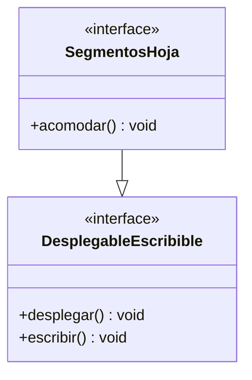
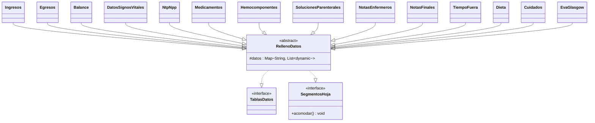
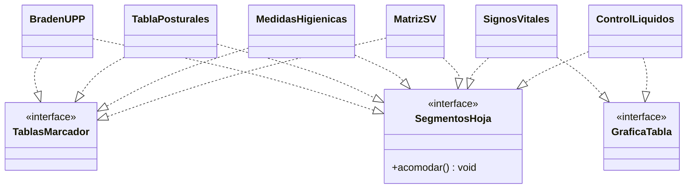
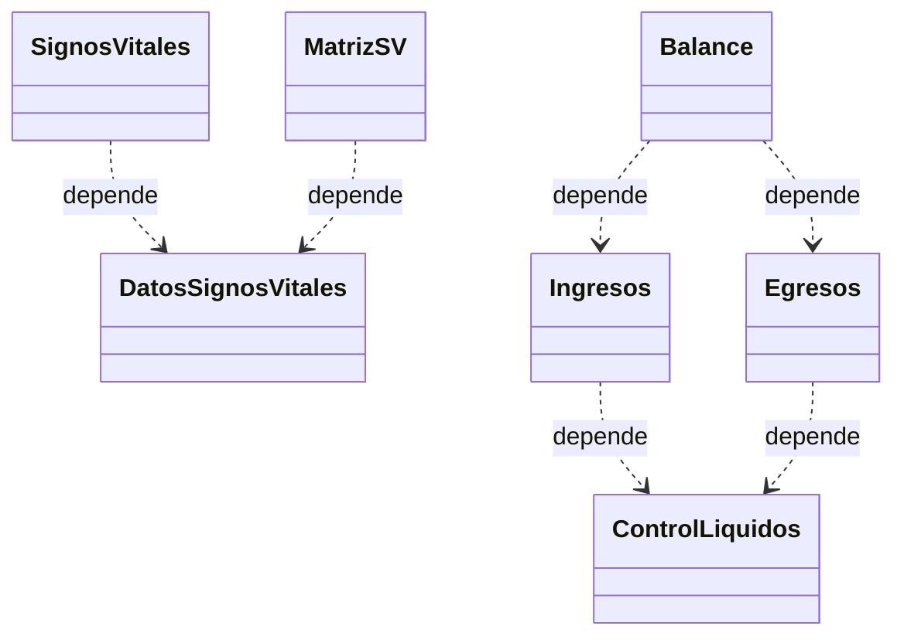
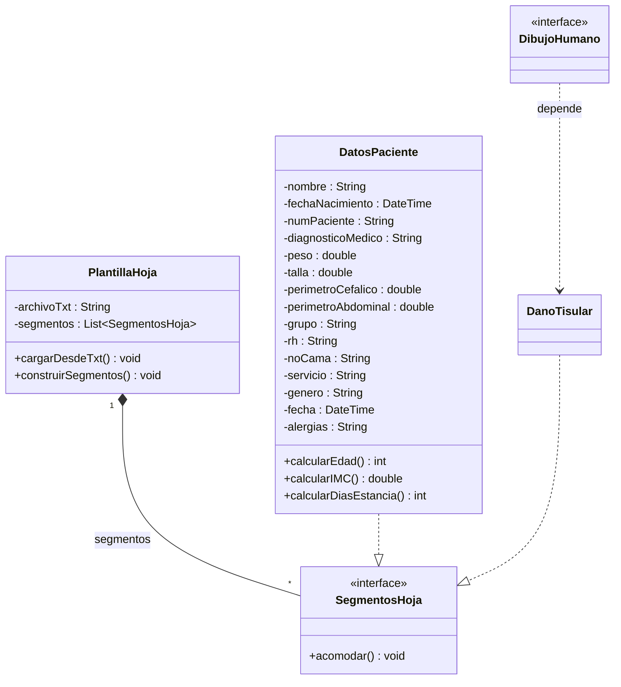

# Hoja de enfermería – Diagrama de clases

Modelo de clases de la hoja de enfermería. El diagrama está dividido en varios para que se lea bien en GitHub.

**Leyenda**

| Flecha | Significado |
|---|---|
| `..\|>` (punteada, triángulo vacío) | Realización (la clase **implementa** una interfaz) |
| `--\|>` (continua, triángulo vacío) | Herencia (clase → clase o interfaz → interfaz) |
| `..>` (punteada, punta abierta) | Dependencia |
| `*--` (rombo lleno) | Composición |

---

## 1. Jerarquía de interfaces

`SegmentosHoja` hereda de `DesplegableEscribible`, que es la combinación de las interfaces "desplegable" y "escribible" en una sola. Todas las clases del modelo, excepto `PlantillaHoja`, implementan `SegmentosHoja`.

---

## 2. Tablas de datos (herencia de `RellenoDatos`)

`RellenoDatos` es una clase abstracta que implementa `TablasDatos` y `SegmentosHoja`, y guarda el mapa de datos. Las 14 clases solo heredan de ella.

---

## 3. Tablas marcador y gráfica de tabla

`ControlLiquidos` implementa únicamente `GraficaTabla` (y `SegmentosHoja`).

---

## 4. Dependencias entre clases

---

## 5. Plantilla, paciente y dibujo humano

---

## Notas y supuestos

- `PlantillaHoja` es una **clase** (no interfaz) porque tiene atributos: el archivo `.txt` y el vector de `SegmentosHoja`.
- `Edad`, `IMC` y `días de estancia` van como **métodos** porque se calculan a partir de fecha de nacimiento, peso/talla y fecha de ingreso.
- `DanoTisular` se asumió como segmento de hoja (implementa `SegmentosHoja`).
- `Dieta`, `Cuidados` y `EvaGlasgow` se asignaron a `TablasDatos`.
- Las interfaces `TablasDatos`, `TablasMarcador`, `GraficaTabla` y `DibujoHumano` todavía no tienen métodos propios.
- Nombres tomados de la captura de Visual Paradigm: `TablasMarcador` ("Tablas rellenar") y `GraficaTabla` ("Tabla").
- En Dart, `vector` se representa con `List`.
