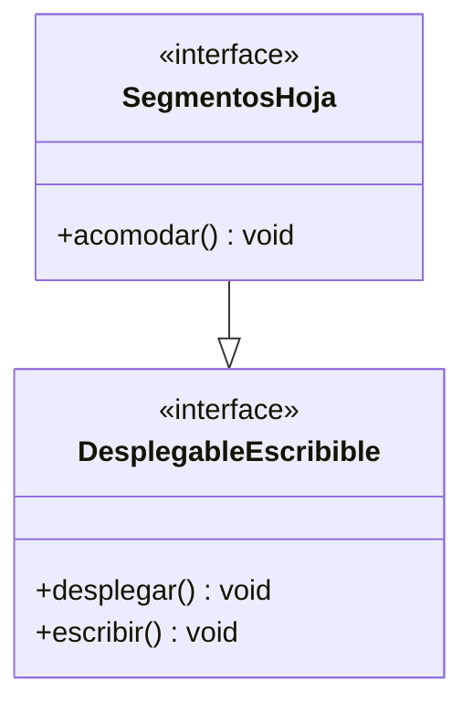
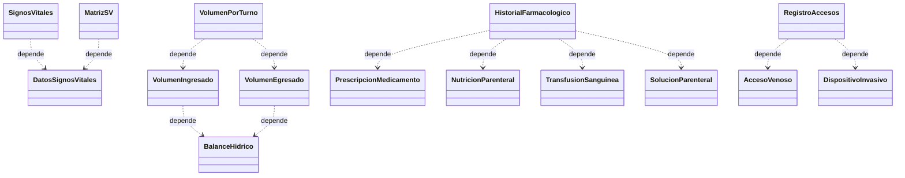
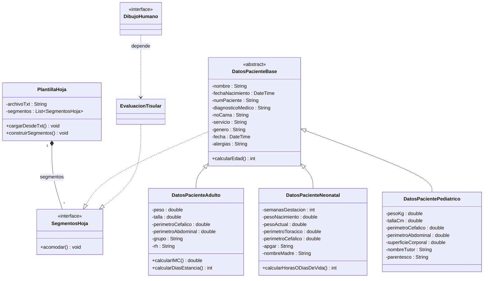

# Hoja de enfermería – Diagrama de clases general (Multiservicios)

Modelo de clases de la hoja de enfermería para Hospitalización, UCIN, UCIP, UCIA, Pre/Postoperatorio y Cirugía. 

**Leyenda**

| Flecha | Significado |
|---|---|
| `..\|>` (punteada, triángulo vacío) | Realización (la clase **implementa** una interfaz) |
| `--\|>` (continua, triángulo vacío) | Herencia (clase → clase o interfaz → interfaz) |
| `..>` (punteada, punta abierta) | Dependencia |
| `*--` (rombo lleno) | Composición |

---

## 1. Jerarquía de interfaces

`SegmentosHoja` hereda de `DesplegableEscribible`, que es la combinación de las interfaces "desplegable" y "escribible" en una sola. Todas las clases del modelo, excepto `PlantillaHoja`, implementan `SegmentosHoja`.

---

## 2. Tablas de datos (herencia de `RellenoDatos`)

`RellenoDatos` es una clase abstracta que implementa `TablasDatos` y `SegmentosHoja`, y guarda el mapa de datos. Las clases que requieren captura de información detallada, números o cadenas de texto complejas heredan de ella, abarcando tanto piso como áreas críticas y quirófano.

```mermaid
classDiagram
    class TablasDatos {
        <<interface>>
    }
    class SegmentosHoja {
        <<interface>>
        +acomodar() void
    }
    class RellenoDatos {
        <<abstract>>
        #datos : Map~String, List~dynamic~~
    }

    RellenoDatos ..|> TablasDatos
    RellenoDatos ..|> SegmentosHoja

    VolumenIngresado --|> RellenoDatos
    VolumenEgresado --|> RellenoDatos
    VolumenPorTurno --|> RellenoDatos
    DatosSignosVitales --|> RellenoDatos
    NutricionParenteral --|> RellenoDatos
    HistorialFarmacologico --|> RellenoDatos
    PrescripcionMedicamento --|> RellenoDatos
    TransfusionSanguinea --|> RellenoDatos
    SolucionParenteral --|> RellenoDatos
    RegistroAccesos --|> RellenoDatos
    AccesoVenoso --|> RellenoDatos
    DispositivoInvasivo --|> RellenoDatos
    TerapiaRespiratoria --|> RellenoDatos
    RegistroDietetico --|> RellenoDatos
    PlanCuidadosEnfermeria --|> RellenoDatos
    MonitoreoHemodinamicoInvasivo --|> RellenoDatos
    ParametrosVentilacionMecanica --|> RellenoDatos
    RegistroQuirurgico --|> RellenoDatos
    ControlHeridaQuirurgica --|> RellenoDatos
    ControlMaterialEInstrumental --|> RellenoDatos
    EquipoQuirurgicoYPosicion --|> RellenoDatos
    MuestrasYBiopsias --|> RellenoDatos
```

---

## 3. Tablas marcador y gráfica de tabla

`BalanceHidrico` y `SignosVitales` implementan `GraficaTabla` (y `SegmentosHoja`). Las clases enfocadas en check-lists, escalas cerradas o variables booleanas (incluyendo escalas específicas para neonatos, pediatría, terapia intensiva y cirugía) implementan `TablasMarcador`.

```mermaid
classDiagram
    class TablasMarcador {
        <<interface>>
    }
    class GraficaTabla {
        <<interface>>
    }
    class SegmentosHoja {
        <<interface>>
        +acomodar() void
    }

    ValoracionUPP ..|> TablasMarcador
    PrevencionUPP ..|> TablasMarcador
    PrevencionCaidas ..|> TablasMarcador
    ManejoPresion ..|> TablasMarcador
    CambioPostural ..|> TablasMarcador
    ControlHigiene ..|> TablasMarcador
    ControlEvacuacion ..|> TablasMarcador
    ManejoOstomia ..|> TablasMarcador
    CuidadoTisular ..|> TablasMarcador
    MatrizSV ..|> TablasMarcador
    AmbienteTermico ..|> TablasMarcador
    ValoracionNeonatal ..|> TablasMarcador
    ValoracionPediatrica ..|> TablasMarcador
    ValoracionNeurologicaYSedacion ..|> TablasMarcador
    PreparacionPreoperatoria ..|> TablasMarcador
    ValoracionPostanestesica ..|> TablasMarcador
    ListaVerificacionCirugiaSegura ..|> TablasMarcador

    SignosVitales ..|> GraficaTabla
    BalanceHidrico ..|> GraficaTabla

    ValoracionUPP ..|> SegmentosHoja
    PrevencionUPP ..|> SegmentosHoja
    PrevencionCaidas ..|> SegmentosHoja
    ManejoPresion ..|> SegmentosHoja
    CambioPostural ..|> SegmentosHoja
    ControlHigiene ..|> SegmentosHoja
    ControlEvacuacion ..|> SegmentosHoja
    ManejoOstomia ..|> SegmentosHoja
    CuidadoTisular ..|> SegmentosHoja
    MatrizSV ..|> SegmentosHoja
    AmbienteTermico ..|> SegmentosHoja
    ValoracionNeonatal ..|> SegmentosHoja
    ValoracionPediatrica ..|> SegmentosHoja
    ValoracionNeurologicaYSedacion ..|> SegmentosHoja
    PreparacionPreoperatoria ..|> SegmentosHoja
    ValoracionPostanestesica ..|> SegmentosHoja
    ListaVerificacionCirugiaSegura ..|> SegmentosHoja
    SignosVitales ..|> SegmentosHoja
    BalanceHidrico ..|> SegmentosHoja
```

---

## 4. Dependencias entre clases

---

## 5. Plantilla, paciente polimórfico y dibujo humano

---

## Notas y supuestos

- `PlantillaHoja` es una **clase** (no interfaz) con atributos para cargar la plantilla y construir dinámicamente los segmentos según el servicio seleccionado.
- Se implementó herencia en `DatosPacienteBase` para soportar perfiles especializados (`DatosPacienteAdulto`, `DatosPacienteNeonatal`, `DatosPacientePediatrico`) sin duplicar atributos universales.
- Las clases exclusivas para áreas críticas (UCIN, UCIP, UCIA) y quirúrgicas (Pre/Postoperatorio y Transoperatorio) se integran de forma modular implementando `TablasMarcador` o heredando de `RellenoDatos`.
- Los apartados de firmas y validación manual se excluyen del modelo digital, ya que se gestionan de forma física en el documento impreso final.
- En Dart, los vectores o colecciones se representan con `List`.